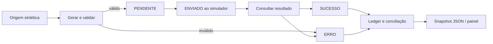

# Migrador Saúde Demo

**Uma migração só termina quando o resultado de cada registro é confirmado.**

[](https://leandroavalle.github.io/migrador-saude-demo/)
[](https://github.com/LeandroAValle/migrador-saude-demo/actions/workflows/showcase.yml)

> A página de portfólio não exibe telas de login ou capturas do ambiente de produção. O simulador deste repositório é uma implementação independente, executada localmente com dados sintéticos.

> Projeto público independente com dados 100% fictícios. Nenhuma chamada é feita à API Betha, a banco de saúde ou ao Migrador Saúde v2 original.

## O que você pode explorar

[**Abrir estudo de caso**](https://leandroavalle.github.io/migrador-saude-demo/) · [Arquitetura](docs/ARCHITECTURE.md) · [Decisões](docs/DECISIONS.md) · [Dados](docs/DATA.md) · [Segurança](docs/SECURITY.md)

O simulador local apresenta domínios ilustrativos, um ledger de execução, totais reconciliados e a trilha por registro. A página GitHub Pages é o estudo de caso visual e não simula a interface de produção.

## Arquitetura



O guard `ensure_writable()` bloqueia qualquer ambiente diferente de `sandbox` antes da operação simulada. O envio muda o estado para `ENVIADO`, mas **não** significa sucesso; somente a consulta simulada determina `SUCESSO` ou `ERRO`.

## Rode localmente

Requisito: Python 3.10+. Não há dependências externas nem credenciais.

```bash
python -m unittest discover -s tests -v
python -m health_demo
python -m http.server 8000 --directory site
```

Abra `http://localhost:8000`. A semente fixa gera o mesmo snapshot em cada execução, e o CI verifica que o arquivo versionado está sincronizado.

## Decisões demonstradas

| Decisão | Por quê |
| --- | --- |
| Bloquear escrita fora do sandbox | Evitar execução acidental em ambiente não autorizado |
| Separar `ENVIADO` de `SUCESSO` | O aceite do lote não confirma o resultado de cada item |
| Manter histórico por chave | Investigar erros sem perder a relação com a origem |
| Conciliar totais por serviço | Detectar registros sem desfecho |
| Usar dados sintéticos | Mostrar o raciocínio sem expor informação de saúde |

## Relação com o projeto profissional

O Migrador Saúde v2 original é um sistema privado em evolução, com backend Python/FastAPI, frontend React/TypeScript, controle de execução e integrações operacionais. Este demo usa apenas os **conceitos** do fluxo, com implementação nova em Python e uma interface estática. Não substitui nem reproduz a aplicação interna.

**Autor:** [Leandro Valle](https://github.com/LeandroAValle) — migração, integrações e engenharia de dados.
